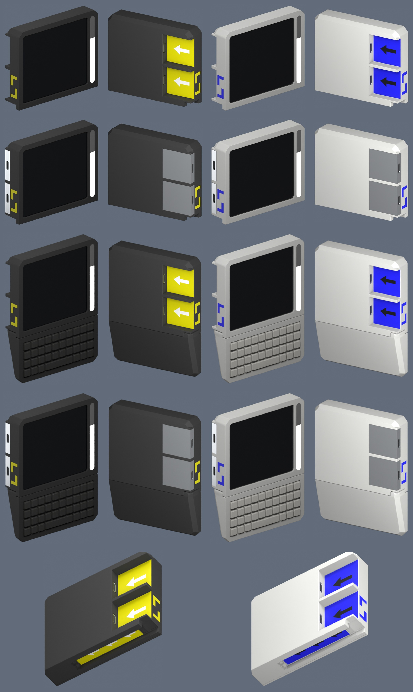

# P14 removable TPU keyboard study

**Concept only — not print-ready or electronics-qualified.** This study adds a
separate rigid case, retaining frame and removable TPU keymat. It does not replace
the original P14 CAD or fused keyboard STL in the parent directory.

The layout has 37 keys: three rows of ten, then three single keys, a centred
four-position space bar and three single keys. The space bar has continuous
rounded rims. The original case exterior slope and rail region are preserved.

## Files

- `assembly.FCStd` / `assembly.step`: separate named parts in assembled positions.
- `exploded.FCStd` / `exploded.step`: the same parts with exaggerated vertical
  offsets for explanation, not manufacturing coordinates.
- `section.FCStd`: a section through one normal key.
- `checks.json`: source hash, assumed dimensions, layout and static CAD checks.
- `p14-opaque-tpu-comparison-tight.jpg`: final charcoal and ivory appearance sheet.

The source is the unchanged `../P14.FCStd`, SHA-256
`2c5018cb604539f488f7940a9939e357876d73541bd553e27f9a5caa00fab593`.

## Mechanism and limitations

A removable rigid frame captures the perimeter flange of one TPU sheet. Thicker
key islands and underside bosses transfer force to purchased PCB tactile switches.
A separate rigid insert sits beneath the space bar; guidance and insert retention
are not yet engineered. The PCB is an unrouted 1.6 mm envelope, with generic
4 × 4 × 2 mm switch bodies and 0.6 mm buttons. The web is 0.4 mm thick, with a
0.15 mm unloaded boss-to-button gap. These are assumptions, not selected hardware
or validated printing tolerances.

CAD checks pass shape validity, deep Boolean-operation checks, no pairwise
volumetric overlap at rest, unchanged rail geometry and unchanged volume after
space-bar seam removal. They do not establish switch travel, tactile feel,
neighbouring-key isolation, fatigue, assembly fit or printability. Frame and PCB
fasteners, travel stops, wiring, connectors and material tuning remain unresolved.
No print-ready separated-part STLs or slicer files are supplied.

## Appearance

The default is opaque TPU approximately matched to the case, with a subtle
pigment and finish difference: warmer ivory and slightly lighter charcoal.
The PCB is hidden beneath the opaque top. These are render targets, not measured
filament colours. In the sheet only, key crowns are raised another 1.5 mm;
the saved mechanism CAD retains its original height. Height is still provisional.

